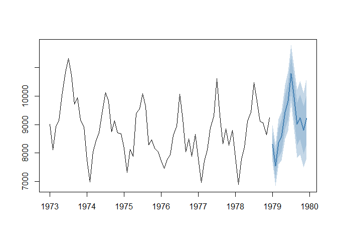

<!-- README.md is generated from README.Rmd. Please edit that file -->

# BayesETS

<!-- badges: start -->

[](https://github.com/LorenzoZambon/BayesETS/actions/workflows/R-CMD-check.yaml)
<!-- badges: end -->

**BayesETS** implements Bayesian ETS (exponential smoothing) state-space
models, which account for both parameter and model uncertainty.
Currently, only additive models are supported. Initial states and the
observation variance are analytically marginalized via conjugate
Normal-Inverse-Chi-Squared priors. The smoothing parameters
($\alpha, \beta, \gamma, \phi$) are integrated numerically, either by
adaptive Gauss-Hermite quadrature (AGHQ) or by adaptive importance
sampling (AIS). Multiple ETS models are combined by Bayesian Model
Averaging (BMA). Forecasts are generated by `predict()`, by simulating
future sample paths.

Key features:

- **Parameter uncertainty**: parameters are integrated over their
  posterior distribution, rather than estimated as point values.
- **Model uncertainty**: multiple ETS models are combined via BMA,
  rather than selecting a single one.
- **Fast**: analytical marginalization reduces the dimension of the
  integration space to (at most) 4; likelihood evaluation is vectorized
  and implemented in C++. On the M3 data, `bets()` takes on average 0.12
  s per monthly series, 0.06 s per quarterly and 0.02 s per yearly one
  (median lengths: 115, 44 and 19 observations), on one core of a laptop
  with an AMD Ryzen 5.

## Installation

You can install the development version from
[GitHub](https://github.com/LorenzoZambon/BayesETS):

``` r
# install.packages("remotes")
remotes::install_github("LorenzoZambon/BayesETS")
```

The package contains C++ code: installing it from GitHub requires a
compiler (Rtools on Windows, the Xcode command line tools on macOS, a
C++ compiler on Linux).

## Basic usage

`bets()` fits the ETS models to a time series and combines them by BMA;
`predict()` computes the forecasts.

``` r
library(BayesETS)
set.seed(123)   # the fit and the forecasts use random draws

fit <- bets(USAccDeaths)   # monthly accidental deaths in the USA, 1973-1978
print(fit)  # for each model, show weight and posterior means of its parameters
#> BETS model fit
#>   call: bets(y = USAccDeaths)
#>   length of the series: 72
#>   frequency: 12
#>   combination: Bayesian Model Averaging
#> 
#>   Model weights and posterior means of the parameters:
#> 
#>   model  weight  alpha   beta    phi  gamma  sigma
#>   ANA     0.814  0.551      -      -  0.255  308.5
#>   AAdA    0.148  0.535  0.049  0.880  0.244  309.6
#>   AAA     0.038  0.567  0.039      -  0.236  312.2
#>   (weight < 0.001: ANN, AAN, AAdN)
#> 
#>   Posterior probability of trend: 0.19, damped trend: 0.15, seasonality: 1.00

fc <- predict(fit, h = 12)   # 80% and 95% prediction intervals by default
print(fc)
#>          Point Forecast     Lo 80     Hi 80    Lo 95     Hi 95
#> Jan 1979       8301.766  7881.922  8716.267 7689.171  8967.764
#> Feb 1979       7546.384  7091.786  8027.522 6829.061  8281.420
#> Mar 1979       8349.965  7849.881  8864.435 7596.950  9184.256
#> Apr 1979       8590.429  8035.455  9168.001 7729.537  9445.045
#> May 1979       9426.844  8830.162 10030.944 8501.737 10389.267
#> Jun 1979       9818.899  9144.074 10474.138 8776.390 10868.761
#> Jul 1979      10786.722 10162.419 11433.339 9744.499 11793.567
#> Aug 1979       9958.223  9203.702 10664.917 8836.971 11027.103
#> Sep 1979       9004.657  8267.894  9770.697 7821.702 10223.417
#> Oct 1979       9247.677  8476.658 10052.002 7950.219 10525.371
#> Nov 1979       8805.281  7970.547  9643.714 7484.997 10109.968
#> Dec 1979       9219.098  8315.700 10049.489 7804.549 10641.805

plot(fc)
```



## Comparison with `forecast::ets()`

### Example: M3 monthly series

We fit `bets()` and `ets()` (from the forecast package) to a monthly
series of the M3 competition, and compare the fitted models and their
forecasts. `ets()` estimates the parameters of each model by maximum
likelihood and selects a single model by AICc. `bets()` fits all the
additive models and averages them, with weights given by their posterior
probabilities; within each model, it integrates over the posterior of
the parameters.

``` r
library(forecast)   # for comparison with ets()
library(Mcomp)      # M3 competition data
library(ggplot2)    # for plot
set.seed(123)

series  <- M3[["N2542"]]
y_train <- series$x
y_test  <- series$xx
h       <- length(y_test)

# Fit the models
bets_fit <- bets(y_train, additive.only = TRUE)
ets_fit  <- ets(y_train, additive.only = TRUE)
```

**Models.** `ets()` selects a single model by AICc, while `bets()`
weighs each model according to its posterior probability:

``` r
ets_fit$method
#> [1] "ETS(A,A,A)"

summ_bets <- summary(bets_fit)  # summary of the fitted models
summ_bets$models
#>   model weight log_evidence
#> 1   ANN 0.0001     -718.163
#> 2   AAN 0.0005     -715.878
#> 3  AAdN 0.0002     -716.761
#> 4   ANA 0.0000     -719.850
#> 5   AAA 0.6701     -708.684
#> 6  AAdA 0.3291     -709.395
```

**Parameters.** For the model selected by `ets()`, ETS(A,A,A), we
compare the maximum likelihood estimates with the posterior distribution
of the same model in `bets()` (summarised by mean, standard deviation
and 95% credible interval):

``` r
# ets(): maximum likelihood estimates
round(c(ets_fit$par[c("alpha", "beta", "gamma")], sigma = sqrt(ets_fit$sigma2)), 4)
#>    alpha     beta    gamma    sigma 
#>   0.6440   0.0001   0.0001 172.9557

# bets(): posterior distribution
post <- summ_bets$parameters$AAA
post
#>           mean      sd     2.5%    97.5%
#> alpha   0.6025  0.0817   0.4487   0.7694
#> beta    0.0580  0.0447   0.0026   0.1763
#> gamma   0.0976  0.0725   0.0035   0.2661
#> sigma 170.5251 12.5618 148.0591 197.2346
```

We can also visualise the posterior distributions of the parameters
using `plot()` (includes shaded 95% credible interval and dashed
posterior mean):

``` r
plot(bets_fit, models = "AAA")   # run plot(bets_fit) to see all models with non-negligible weights
```


The posterior distribution quantifies the uncertainty around the
parameter estimates. For example, `ets()` estimates $\hat\alpha$ = 0.64,
while the 95% credible interval of `bets()` goes from 0.45 to 0.77;
`bets()` carries this uncertainty into the forecasts.

**Forecasts.** We compute the forecasts of both models over the test
set:

``` r
bets_fc <- predict(bets_fit, h = h, level = c(80, 95))
ets_fc  <- forecast(ets_fit, h = h, level = c(80, 95))
```

We plot the last years of the series with the forecasts of both models
(80% and 95% prediction intervals) and the observed test set (dashed).
The intervals of `bets()` are larger, as they account for the
uncertainty on the parameters and on the model, while those of `ets()`
are conditional on the estimates of the selected model.


### Benchmark on the M3 data

We compare `bets()` and `ets()` (additive models only) on all the
yearly, quarterly and monthly series of the M3 dataset (2829 series),
with the M3 test sets (horizons 6, 8 and 18):

- **MASE**: mean absolute error (MAE) of the point forecasts, scaled by
  the in-sample MAE of the seasonal naive forecast;
- **MSIS**: interval score of the 95% intervals, with the same scaling
  (lower is better);
- **Coverage** of the 80% and 95% prediction intervals;
- **Time**: average time per series (includes both fit and forecast).

<table>
<thead><tr><th>Period (series)</th><th>Method</th><th>MASE</th><th>Coverage 80%</th>
<th>Coverage 95%</th><th>MSIS</th><th>Time (s)</th></tr></thead>
<tbody>
<tr><td rowspan="2">Yearly (645)</td><td>ets</td><td align="right">2.893</td><td align="right">0.645</td><td align="right">0.780</td><td align="right">41.87</td><td align="right">0.004</td></tr>
<tr><td>bets</td><td align="right">2.868</td><td align="right">0.717</td><td align="right">0.869</td><td align="right">31.53</td><td align="right">0.024</td></tr>
<tr><td rowspan="2">Quarterly (756)</td><td>ets</td><td align="right">1.177</td><td align="right">0.690</td><td align="right">0.839</td><td align="right">11.90</td><td align="right">0.034</td></tr>
<tr><td>bets</td><td align="right">1.167</td><td align="right">0.745</td><td align="right">0.899</td><td align="right">10.05</td><td align="right">0.067</td></tr>
<tr><td rowspan="2">Monthly (1428)</td><td>ets</td><td align="right">0.880</td><td align="right">0.761</td><td align="right">0.904</td><td align="right">7.06</td><td align="right">0.134</td></tr>
<tr><td>bets</td><td align="right">0.868</td><td align="right">0.820</td><td align="right">0.946</td><td align="right">6.57</td><td align="right">0.119</td></tr>
</tbody>
</table>

The script is in
[`benchmark/m3_benchmark.R`](https://github.com/LorenzoZambon/BayesETS/blob/main/benchmark/m3_benchmark.R).

## Current limitations

- Only additive models are supported (additive error, trend and
  seasonality).
- The series must not contain missing values.
- Exogenous regressors are not supported.
