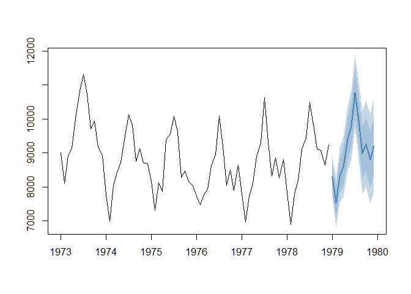
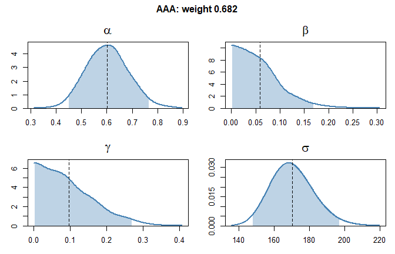
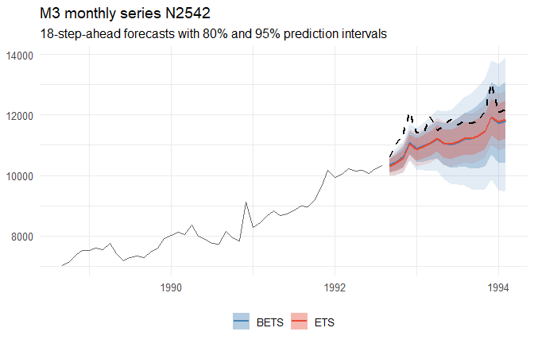

<!-- README.md is generated from README.Rmd. Please edit that file -->

# BayesETS

<!-- badges: start -->

[](https://github.com/LorenzoZambon/BayesETS/actions/workflows/R-CMD-check.yaml)
<!-- badges: end -->

**BayesETS** implements Bayesian ETS (exponential smoothing) state-space
models, which account for both parameter and model uncertainty.
Currently, only additive models are supported. Initial states and the
observation variance are analytically marginalized via conjugate
Normal-Inverse-Chi-Squared priors. The smoothing parameters
($\alpha, \beta, \gamma, \phi$) are integrated numerically, either by
adaptive Gauss-Hermite quadrature (AGHQ) or by adaptive importance
sampling (AIS). Multiple ETS models are combined by Bayesian Model
Averaging (BMA). `predict()` computes the forecast distribution in
closed form, as a mixture of Student-t distributions; sample paths can
be simulated on request.

Key features:

- **Parameter uncertainty**: parameters are integrated over their
  posterior distribution, rather than estimated as point values.
- **Model uncertainty**: multiple ETS models are combined via BMA,
  rather than selecting a single one.
- **Fast**: analytical marginalization reduces the dimension of the
  integration space to (at most) 4; likelihood evaluation is vectorized
  and implemented in C++. On the M3 data, `bets()` takes on average 0.10
  s per monthly series, 0.05 s per quarterly and 0.02 s per yearly one
  (median lengths: 115, 44 and 19 observations), on one core of a laptop
  with an AMD Ryzen 5.

## Installation

You can install the development version from
[GitHub](https://github.com/LorenzoZambon/BayesETS):

``` r
# install.packages("remotes")
remotes::install_github("LorenzoZambon/BayesETS")
```

The package contains C++ code: installing it from GitHub requires a
compiler (Rtools on Windows, the Xcode command line tools on macOS, a
C++ compiler on Linux).

## Basic usage

`bets()` fits the ETS models to a time series and combines them by BMA;
`predict()` computes the forecasts.

``` r
library(BayesETS)
set.seed(123)   # the fit uses random draws

fit <- bets(USAccDeaths)   # monthly accidental deaths in the USA, 1973-1978
print(fit)  # for each model, show weight and posterior means of its parameters
#> BETS model fit
#>   call: bets(y = USAccDeaths)
#>   length of the series: 72
#>   frequency: 12
#>   combination: Bayesian Model Averaging
#> 
#>   Model weights and posterior means of the parameters:
#> 
#>   model  weight  alpha   beta    phi  gamma  sigma
#>   ANA     0.815  0.551      -      -  0.255  308.5
#>   AAdA    0.147  0.534  0.049  0.880  0.246  309.7
#>   AAA     0.038  0.567  0.039      -  0.237  312.3
#>   (weight < 0.001: ANN, AAN, AAdN)
#> 
#>   Posterior probability of trend: 0.19, damped trend: 0.15, seasonality: 1.00

fc <- predict(fit, h = 12)   # 80% and 95% prediction intervals by default
print(fc)
#>          Point Forecast     Lo 80     Hi 80    Lo 95     Hi 95
#> Jan 1979       8295.289  7891.417  8699.241 7673.019  8917.905
#> Feb 1979       7528.250  7062.009  7996.059 6810.765  8253.395
#> Mar 1979       8324.764  7805.750  8846.633 7525.030  9138.498
#> Apr 1979       8578.847  8012.015  9149.123 7702.838  9471.991
#> May 1979       9400.279  8788.736 10015.407 8451.861 10367.907
#> Jun 1979       9803.808  9147.659 10464.722 8785.134 10849.934
#> Jul 1979      10778.914 10087.743 11475.229 9702.169 11884.363
#> Aug 1979       9960.001  9230.346 10693.827 8819.611 11129.963
#> Sep 1979       8993.089  8230.795  9759.761 7798.495 10219.873
#> Oct 1979       9246.871  8448.065 10050.869 7994.578 10539.894
#> Nov 1979       8803.612  7975.404  9639.235 7504.728 10154.822
#> Dec 1979       9206.914  8347.720 10073.327 7855.241 10609.773

plot(fc)
```



## Comparison with `forecast::ets()`

### Example: M3 monthly series

We fit `bets()` and `ets()` (from the forecast package) to a monthly
series of the M3 competition, and compare the fitted models and their
forecasts. `ets()` estimates the parameters of each model by maximum
likelihood and selects a single model by AICc. `bets()` fits all the
additive models and averages them, with weights given by their posterior
probabilities; within each model, it integrates over the posterior of
the parameters.

``` r
library(forecast)   # for comparison with ets()
library(Mcomp)      # M3 competition data
library(ggplot2)    # for plot
set.seed(123)

series  <- M3[["N2542"]]
y_train <- series$x
y_test  <- series$xx
h       <- length(y_test)

# Fit the models
bets_fit <- bets(y_train, additive.only = TRUE)
ets_fit  <- ets(y_train, additive.only = TRUE)
```

**Models.** `ets()` selects a single model by AICc, while `bets()`
weighs each model according to its posterior probability:

``` r
ets_fit$method
#> [1] "ETS(A,A,A)"

summ_bets <- summary(bets_fit)  # summary of the fitted models
summ_bets$models
#>   model weight log_evidence
#> 1   ANN 0.0001     -718.163
#> 2   AAN 0.0005     -715.878
#> 3  AAdN 0.0002     -716.746
#> 4   ANA 0.0000     -719.850
#> 5   AAA 0.6817     -708.675
#> 6  AAdA 0.3175     -709.440
```

**Parameters.** For the model selected by `ets()`, ETS(A,A,A), we
compare the maximum likelihood estimates with the posterior distribution
of the same model in `bets()` (summarised by mean, standard deviation
and 95% credible interval):

``` r
# ets(): maximum likelihood estimates
round(c(ets_fit$par[c("alpha", "beta", "gamma")], sigma = sqrt(ets_fit$sigma2)), 4)
#>    alpha     beta    gamma    sigma 
#>   0.6440   0.0001   0.0001 172.9557

# bets(): posterior distribution
post <- summ_bets$parameters$AAA
post
#>           mean      sd     2.5%    97.5%
#> alpha   0.6021  0.0813   0.4519   0.7659
#> beta    0.0588  0.0450   0.0018   0.1690
#> gamma   0.0965  0.0719   0.0033   0.2687
#> sigma 170.4624 12.5581 147.9979 197.1597
```

We can also visualise the posterior distributions of the parameters
using `plot()` (includes shaded 95% credible interval and dashed
posterior mean):

``` r
plot(bets_fit, models = "AAA")   # run plot(bets_fit) to see all models with non-negligible weights
```



The posterior distribution quantifies the uncertainty around the
parameter estimates. For example, `ets()` estimates $\hat\alpha$ = 0.64,
while the 95% credible interval of `bets()` goes from 0.45 to 0.77;
`bets()` carries this uncertainty into the forecasts.

**Forecasts.** We compute the forecasts of both models over the test
set:

``` r
bets_fc <- predict(bets_fit, h = h, level = c(80, 95))
ets_fc  <- forecast(ets_fit, h = h, level = c(80, 95))
```

We plot the last years of the series with the forecasts of both models
(80% and 95% prediction intervals) and the observed test set (dashed).
The intervals of `bets()` are larger, as they account for the
uncertainty on the parameters and on the model, while those of `ets()`
are conditional on the estimates of the selected model.



### Benchmark on the M3 data

We compare `bets()` and `ets()` (additive models only) on all the
yearly, quarterly and monthly series of the M3 dataset (2829 series),
with the M3 test sets (horizons 6, 8 and 18):

- **MASE**: mean absolute error (MAE) of the point forecasts, scaled by
  the in-sample MAE of the seasonal naive forecast;
- **MSIS**: interval score of the 95% intervals, with the same scaling
  (lower is better);
- **Coverage** of the 80% and 95% prediction intervals;
- **Time**: average time per series (includes both fit and forecast).

<table>
<thead><tr><th>Period (series)</th><th>Method</th><th>MASE</th><th>Coverage 80%</th>
<th>Coverage 95%</th><th>MSIS</th><th>Time (s)</th></tr></thead>
<tbody>
<tr><td rowspan="2">Yearly (645)</td><td>ets</td><td align="right">2.893</td><td align="right">0.645</td><td align="right">0.780</td><td align="right">41.87</td><td align="right">0.003</td></tr>
<tr><td>bets</td><td align="right">2.862</td><td align="right">0.718</td><td align="right">0.873</td><td align="right">31.37</td><td align="right">0.016</td></tr>
<tr><td rowspan="2">Quarterly (756)</td><td>ets</td><td align="right">1.177</td><td align="right">0.690</td><td align="right">0.839</td><td align="right">11.90</td><td align="right">0.029</td></tr>
<tr><td>bets</td><td align="right">1.168</td><td align="right">0.748</td><td align="right">0.901</td><td align="right">9.99</td><td align="right">0.052</td></tr>
<tr><td rowspan="2">Monthly (1428)</td><td>ets</td><td align="right">0.880</td><td align="right">0.761</td><td align="right">0.904</td><td align="right">7.06</td><td align="right">0.128</td></tr>
<tr><td>bets</td><td align="right">0.866</td><td align="right">0.822</td><td align="right">0.947</td><td align="right">6.53</td><td align="right">0.101</td></tr>
</tbody>
</table>

The script is in
[`benchmark/m3_benchmark.R`](https://github.com/LorenzoZambon/BayesETS/blob/main/benchmark/m3_benchmark.R).

## Current limitations

- Only additive models are supported (additive error, trend and
  seasonality).
- The series must not contain missing values.
- Exogenous regressors are not supported.
